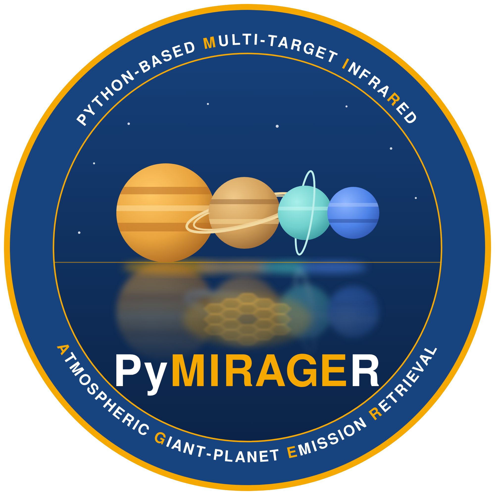

<p align="center">
  
</p>

# PyMIRAGER
## Python-based Multi-target InfraRed Atmospheric Giant-planet Emission Retrieval

**PyMIRAGER v0.4.7** is an evolving **0.x research software package** for **Jupiter's thermal-infrared (approximately 5–20 µm) atmosphere**. It provides an LTE (local thermodynamic equilibrium) thermal-emission forward model and regularized retrievals derived from legacy Fortran calculations.

> **Scientific scope — v0.x:** Jupiter only; the molecular species and historical opacity-table formats supported by the current Jupiter cases; and **grey, absorption-only aerosols in LTE**. This release does **not** model aerosol scattering, wavelength-dependent aerosol optical properties, non-LTE emission, or the atmospheres of other planets. These are future development possibilities, **not implemented capabilities**.

The current version is intended for the verified Jupiter setups and is **not a general-purpose planetary radiative-transfer package**. Code and validation reports remain versioned as `0.x` while the scope and scientific tests evolve.

## Implemented capabilities

- Thermal-emission forward model using the Planck function under LTE, atmospheric geometry, molecular opacity tables, and H₂–H₂, H₂–He, and H₂–CH₄ collision-induced absorption.
- Temperature-profile retrieval, normal molecular-abundance retrievals, and dedicated pathways for **HCN, CO₂, H₂O, and C₆H₆**.
- Grey, absorption-only aerosol retrieval with optional fixed-zero vertical boundaries (no aerosol scattering).
- Regularized inversion with Jacobians, formal errors, averaging-kernel summaries, DOFS, and iteration diagnostics.
- CLI presets that select regularization and instrumental settings. **Species and retrieval flags are specified by `.fuel`, not by the preset name.**

**Molecular scope:** The Jupiter reference cases include opacity identifiers such as `ch5`, `ch3e`, `nh3`, `ph3`, `c2h3`, and `c2h6`, with special retrieval support for `hcn`, `co2`, `h2o`, and `c6h6`. These are historical **file identifiers**, not necessarily chemical formulae: in particular `c2h3` is used for the validated C₂H₂ case. A molecular opacity table `jupiter_ch4_<gas>.opa` is required for **each** gas in `.fuel`. The file reader's ability to load a name does **not** imply that every possible species is scientifically supported or validated. Do not use this implementation for arbitrary new species without first adapting and validating the opacity data and forward model.

## Scientific validation

Comparisons with the Fortran reference have been carried out for CIA, temperature, a normal **C₂H₂** case, **C₆H₆**, **CO₂**, and **grey aerosol retrievals**. Aerosols were assessed with a fixed allowed band **80–119** in v0.4.6: mean χ² approximately **6.696821**, DOFS approximately **0.907569**, peak at level **115**, and integrated layer optical depth approximately **0.004221** (Fortran reference: approximately **0.002800**). Their profiles are similar but **not numerically identical**. These are results for a specific Jupiter case, not universal benchmarks.

**Important for v0.4.7:** the aerosol band's lower cutoff changes to **85**, allowing levels **85–119**. This new boundary has been tested in code but **has not yet undergone a full scientific retrieval with the external `.opa` data**. **HCN and H₂O have not been individually validated against Fortran.** See [validation details](docs/VALIDATION.md) for exact limitations.

## Installation

Requirements: Linux (validated platform), Python 3.10 or newer, NumPy, SciPy, Jupiter case files, and **external binary molecular `.opa` tables**. The large opacity tables and observational inputs are not bundled.

```bash
conda activate jwst_neptune  # or any Python >= 3.10 environment
cd ~/MIRAGER/Jupiter_RT_Python
python3 -m pip install -e .
python3 -m jupiter_rt --version
```

The distribution name is `jupiter-rt-retrieval`; the Python package and command-line module are `jupiter_rt`.

## Running a Jupiter case

The input directory must contain `jupiter_ch4.fuel`, `.pta`, `.spe`, `resolution.txt`, and `corrch4.txt`. Aerosol cases additionally require the appropriate cloud-mask file (`ch4_hazes.txt` for `cloud 2`, or `nh3_clouds.txt` for `cloud 1`). **The input directory is separate from the code repository.**

Check the case without reading the potentially large opacity tables:

```bash
cd ~/MIRAGER
python3 -m jupiter_rt --case . --preset aerosol_cutoff --check-inputs
```

Example LTE grey-aerosol retrieval:

```bash
python3 -u -m jupiter_rt \
  --case . \
  --opacity-dir /path/to/jupiter/opacity/tables \
  --preset aerosol_cutoff \
  --output resultados_aerosol_85_120 \
  | tee log_aerosol_85_120.txt
```

In v0.4.7, `aerosol_cutoff` enforces **`taucloud[:85] = 0` and `taucloud[120:] = 0`**, with retrieval allowed only at zero-based indices **85–119**. This will force the retrieval of a haze layer at around 20 mbar, compatible with previous results. The independently supplied `ch4_hazes.txt` or `nh3_clouds.txt` mask still controls sensitivity in the aerosol Jacobian. `aerosol` (without fixed cutoffs) and `aerosol_legacy` are retained unchanged. These zero boundaries are **user-selected constraints**, not an explicit Fortran altitude cutoff.

The `temperature`, `abundance`, `abundance_split`, `hcn`, `co2`, `h2o`, `c6h6`, and `c6h6_fortran` presets are also available. Using `--preset co2` does **not** automatically select CO₂: it must already be specified in the `.fuel` file along with the correct `.pta` and `.opa` files.

Outputs include `jupiter_ch4.res`, `.inv`, `.sum`, `.avg`, and `diagnostics.json` (the latter records `software_version`, `preset`, and retrieval settings). The reported χ² is a **mean** normalized squared residual, not necessarily a reduced χ².

## Documentation

- [Technical guide](docs/TECHNICAL_GUIDE.md) — model, installation, presets, inversion, and CLI.
- [Input/output formats](docs/FILE_FORMATS.md) — `.fuel`, `.pta`, `.spe`, `.opa`, cloud masks, and scaling.
- [Scientific validation](docs/VALIDATION.md) — Fortran comparisons, what has and has not been validated.
- [Changelog](CHANGELOG.md) and [v0.4.7 release notes](docs/RELEASE_NOTES_0.4.7.md).

## Roadmap (not yet implemented)

Potential extensions include additional **planetary atmospheres**, **new molecular species and opacity sets**, wavelength-dependent aerosol models and/or scattering, and non-LTE radiative transfer. Each would require separate physical implementation, new input conventions, and independent validation. **No timeline or compatibility guarantee is implied.**

## Project repository

https://github.com/PabloROvalle/PyMIRAGER-

**Research-software caution:** Always archive the software version, case inputs, opacity-table provenance, chosen preset, mask, regularization, and observing geometry with published retrieval results. The package contains no observational products or `.opa` files.
